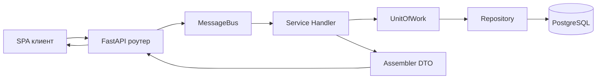
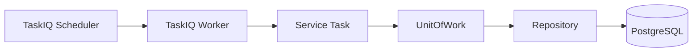
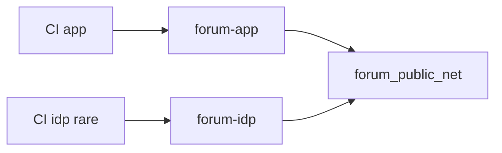

# Forum


Fullstack-форум для тематических обсуждений, личных диалогов
и обратной связи с поддержкой. В основе — асинхронный backend,
OIDC-авторизация через Keycloak и SPA-фронтенд на vanilla JS.

## О проекте

Форум объединяет разделы и темы, личные чаты, уведомления и поддержку
в одном приложении. На главной — активность сообщества и быстрые
переходы к обсуждениям. Для скрытых категорий и тем есть ACL,
для пользователей — роли и отдельный admin-интерфейс.

На backend я разделил домен, сервисный слой и инфраструктуру:
команды идут через MessageBus и Unit of Work, данные — через
репозитории в PostgreSQL. Фоновые задачи (например, очистка
уведомлений) крутятся на TaskIQ. На frontend — hash-SPA с бейджами
непрочитанных, deep-link в посты и пометкой ЛС прочитанными
по видимости в viewport.

## Возможности

### Форум и контент

- разделы и категории с витриной на главной;
- темы и сообщения с пагинацией, цитированием и ответами;
- редактирование в рамках временного окна;
- фильтры «активные темы» и «с вашим участием».

### Личные чаты

- диалоги 1-на-1;
- список диалогов с превью последнего сообщения;
- счётчик непрочитанных в шапке и на каждом диалоге;
- авто-пометка сообщений прочитанными при появлении в viewport.

### Уведомления

- уведомления на ответы и цитаты;
- прочтение, удаление одного и очистка всех;
- бейджи непрочитанных;
- ежедневная очистка неактивных записей фоновой задачей.

### Авторизация и роли

- вход через Keycloak (OIDC);
- HttpOnly cookies и refresh сессии;
- публичные и приватные маршруты;
- admin-интерфейс и операции с проверкой прав.

### Поддержка и контакт

- форма обращений с суточными лимитами;
- страница контактных каналов.

## Технологии

### Backend

- Python 3.12
- FastAPI
- SQLAlchemy (async)
- PostgreSQL
- Alembic
- Redis
- TaskIQ + TaskIQ Scheduler
- Pydantic
- pytest

### Frontend

- Vanilla JavaScript (SPA на hash-router)
- HTML / CSS
- Nginx

### Auth и инфраструктура

- Keycloak (OIDC)
- Docker Compose
- pgAdmin

## Архитектура и логика работы

Слои приложения:

- `domain` — команды, схемы, модели, бизнес-исключения;
- `service_layer` — handlers, message bus, UoW, assemblers;
- `adapters/repositories` — доступ к данным;
- `interfaces/api` — HTTP-роутеры и маппинг ошибок.

### Поток пользовательского запроса



### Поток фоновой задачи



### Отдельные сценарии

- **Access Control List** — видимость скрытых категорий и тем через whitelist
  на уровне категории и отдельных тем.
- **Гости** — cookie анонимного посетителя и merge в аккаунт
  при логине.
- **Антиспам** — лимиты на частоту сообщений и создание тем.
- **MessageBus** — команды возвращают результат клиенту;
  события обрабатываются best-effort и не ломают основной поток.

## Деплой на VPS (app и Keycloak раздельно)

Локально по-прежнему один файл `docker-compose.yaml`
(приложение + Keycloak вместе).

На production стеки разделены, чтобы CI приложения не
перезапускал IdP:

| Стек | Compose | Когда обновлять |
|------|---------|-----------------|
| IdP | `docker-compose.keycloak.prod.yaml` | редко (темы, SPI, KC) |
| App | `docker-compose.app.prod.yaml` | почти каждый деплой |



Порядок на сервере:

```bash
docker network create forum_public_net

# IdP (один раз / редко)
docker compose -p forum-idp \
  -f docker-compose.keycloak.prod.yaml up -d

# Приложение (CI)
docker compose -p forum-app \
  -f docker-compose.app.prod.yaml up -d --build
```

В prod `.env` важно:

- `FORUM_KC_HOSTNAME` — публичный hostname Keycloak
- `FORUM_KEYCLOAK_BASE_URL` — URL для браузера
- `FORUM_KEYCLOAK_INTERNAL_URL=http://keycloak:8080`
  (имя сервиса IdP-стека в общей сети)
- `FORUM_DOCKER_NETWORK=forum_public_net`

У Keycloak DB — named volume `keycloak_pg_data`:
realm и пользователи переживают рестарт контейнера.

### Миграции Alembic

Ревизии не хранятся в git: при старте API (`app.sh`) сравнивает
модели с БД, при отличиях делает `--autogenerate` и `upgrade head`.
Файлы лежат в volume `alembic_versions` внутри Docker.

## Дополнительно

- Backend: [backend/README.md](backend/README.md)
- Согласие на регистрации (Keycloak SPI):
  [keycloak-spi/README.md](keycloak-spi/README.md)
